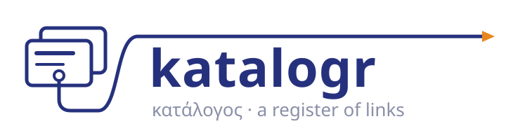
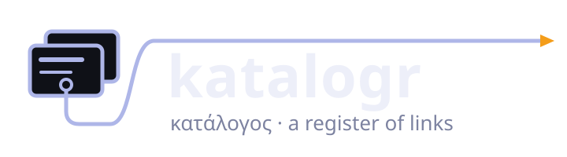

# katalogr

  
  

katalogr is an indexing and cross-referencing tool for code and documents. It builds a
deterministic graph that traces every file, function and method, in any technology and across the
connections between them, so that people and AI coding agents can ask where something is defined,
what refers to it and why it is there.

## What it commits to

- Full traceability of every atomic code block (file, function, method) in a polyglot repository.
- Cross-repository scanning, with dependencies that can be followed in both directions.
- Dependencies traced for vulnerability assessment.
- Connections between languages traced through the protocol or interface between them.
- Support for many languages from the start, and room to add more.
- Quality metrics tracked over time and enforceable as gates.

## Design constraints

- **One binary.** It installs from a script and needs no toolchain beyond what a release provides.
  Building from source needs `cargo` only.
- **A neutral core.** The core names no language, format or protocol. Each is an extension.
- **Usable without an agent.** Every query works from the command line, in CI and in an editor.
  Agent integration (a skill and hooks for Claude Code, an MCP server for other hosts) speeds
  work up and never gates it.
- **Private by default.** The names, paths and code of scanned repositories never leave the index
  that was built from them.

## Contributing and security

See [CONTRIBUTING](https://github.com/startr-trade/katalogr/blob/main/CONTRIBUTING.md) to propose
a change and [SECURITY](https://github.com/startr-trade/katalogr/blob/main/SECURITY.md) to report
a vulnerability privately.
